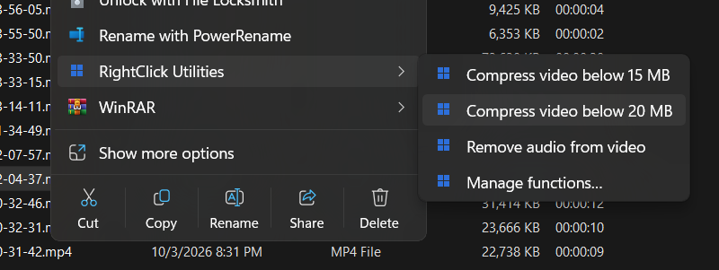
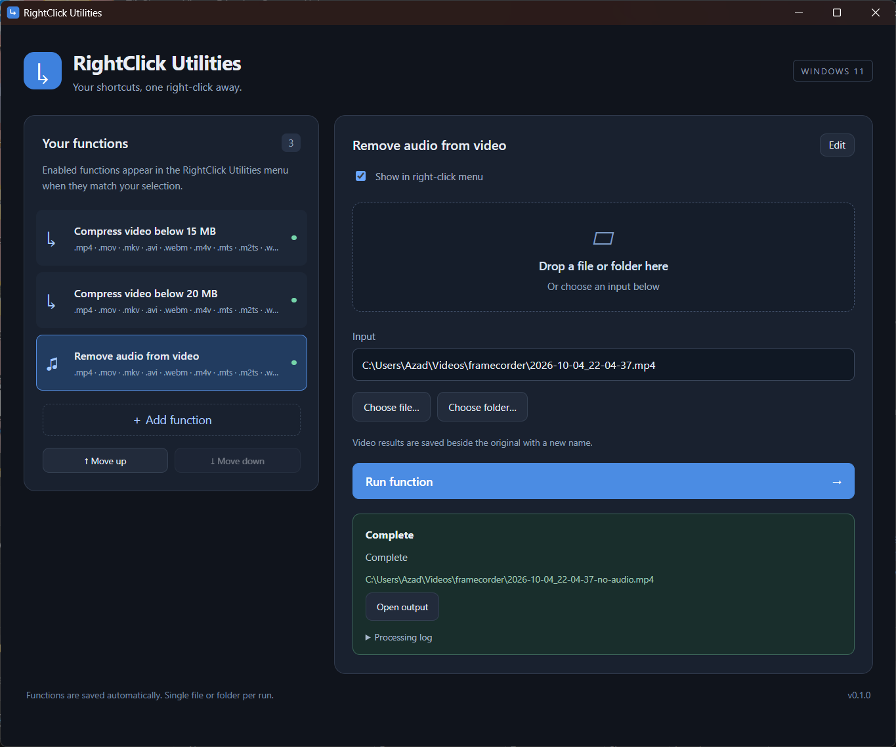

# RightClick Utilities

A standalone Windows 11 app that adds a **RightClick Utilities** submenu to Explorer for files and folders. Build your own shortcuts by pairing a menu label with a program and its arguments.



## Included functions

- **Compress video below 15 MB**
- **Compress video below 20 MB**
- **Convert for iPhone** — compresses below 20 MB as H.264/AAC MP4 for iPhone playback and saving to Photos.
- **Remove audio from video** — creates a silent copy without re-encoding the video.

Video outputs are saved beside the original with a new name. Existing files are protected. Compression preserves the full duration and checks the actual output size. Limits use decimal MB (1 MB = 1,000,000 bytes).

Video content is checked with ffprobe. Audio-only files, images, and fake videos are rejected, even if renamed to `.mp4`. Compression produces H.264/AAC MP4 and retains the first video/audio tracks. Audio removal copies the non-audio streams into the chosen container.

**Convert for iPhone** uses the same encoder as the 20 MB compression function. MOV is not required: [Apple supports H.264 video in MP4 containers](https://developer.apple.com/documentation/technologyoverviews/video). Outputs use the `-20MB.mp4` suffix and preserve the full video duration.

## Use the app



Open `release/Utilities.exe`. Choose a function, select or drop one file or folder, and click **Run function**. The app shows progress, cancellation, errors, and an **Open output** button.

Use **Add function** or **Edit** to change the label, program, arguments, extension filters, and file/folder applicability. Enable or disable functions with the checkbox, and reorder them with **Move up/down**. The first version supports one selected item at a time.

Arguments are entered one per line, without surrounding quotes. Supported placeholders:

| Placeholder | Value |
| --- | --- |
| `{input}` | Selected file or folder |
| `{parent}` | Its parent folder |
| `{stem}` | Its name without an extension |
| `{tools}` | Installed tools directory |
| `{cli}` | Built-in CLI executable |

Programs receive individual arguments directly. For scripts, choose their interpreter as the program and pass the script path as an argument. Functions are stored in `%USERPROFILE%\.rightclick-utilities\functions.json` and shared by the app, CLI, and Explorer extension.

## Build

Requires Windows 11 x64, Node.js/npm, Rust with the MSVC toolchain, Visual Studio 2022 Community C++ desktop tools, Windows SDK 10.0.26100.0, and WebView2. FFmpeg and ffprobe must be installed together; FFmpeg must include libx264 and AAC.

```powershell
git clone https://github.com/azadbal/RightClick-Utilites.git
cd RightClick-Utilites
npm.cmd ci
.\scripts\build.ps1 -FFmpegDirectory 'C:\Tools\ffmpeg\bin'
```

Omit `-FFmpegDirectory` to use FFmpeg from PATH. The build copies both FFmpeg executables beside the app so desktop launches work without a developer shell. Generated binaries, media fixtures, and local certificates are excluded from source control.

For development, build the CLI with `cargo build --release --manifest-path cli/Cargo.toml`, then run `npm.cmd run tauri -- dev`.

## Install the Explorer menu

```powershell
.\scripts\install.ps1
```

The installer copies the app to `%USERPROFILE%\.rightclick-utilities\app`, signs a local sparse MSIX identity, and registers the modern Windows 11 submenu. It keeps menu construction fast and runs processing outside Explorer.

On Windows builds requiring machine certificate trust, the first installation returns a certificate-trust error. Run this prepared helper **as administrator, using the same Windows account**:

```powershell
.\package\install-with-machine-trust.ps1
```

It trusts only the recorded local signing certificate and registers the package for your account. No script enables Developer Mode or restarts Explorer. Sign out and back in if Explorer caches the old menu. See [Explorer integration](package/README.md) for details.

To remove the menu and installer-created certificates, run `.\scripts\uninstall.ps1`. Administrator access is required when removing machine certificate trust. Function settings and application files are preserved.

## CLI

The CLI runs independently of the GUI:

```powershell
.\release\UtilitiesCli.exe compress 'C:\Videos\clip.mp4' --max-mb 20 --json
.\release\UtilitiesCli.exe strip-audio 'C:\Videos\clip.mp4' --json
.\release\UtilitiesCli.exe run video-15mb 'C:\Videos\clip.mp4' --json
.\release\UtilitiesCli.exe functions --json
.\release\UtilitiesCli.exe --help
```

Direct video commands support `--output <path>` and explicit `--overwrite`. Originals cannot be replaced. `run` and `functions` accept `--config <path>`. JSON results go to stdout; progress and diagnostics go to stderr. Failures return nonzero exit codes. See [the CLI contract](cli/README.md) for the function schema and full behavior.

## Source layout

- `cli/`: Rust runner and video processing.
- `ui/` and `src-tauri/`: React/TypeScript GUI and desktop host.
- `shell/`: Native C++ `IExplorerCommand` submenu.
- `package/` and `scripts/`: Windows registration and build/install scripts.
- `tests/`: Generated-fixture FFmpeg integration checks.

The GUI and Explorer use the same CLI implementation. No background service or plugin runtime is required.

## Checks

```powershell
cargo test --manifest-path cli/Cargo.toml
npm.cmd run build
.\scripts\build-shell.ps1 -Test
python tests/test_video_functions.py
```

The initial implementation passed CLI/core tests, eight real FFmpeg integration tests, and the native shell harness. The standalone GUI and modern Explorer submenu were checked on Windows 11 x64. Other platforms are not supported yet.

Forced cancellation can leave an `.rightclick-utilities-*` temporary directory, but incomplete output is never published as a completed result.

## Licensing

RightClick Utilities is licensed under the [MIT License](LICENSE), allowing personal and commercial use, modification, and redistribution.

Third-party dependencies retain their own licenses. FFmpeg retains its own license; the local build used during development is GPL. FFmpeg binaries are not committed. Check your supplied build with `ffmpeg -L` before redistributing it.
